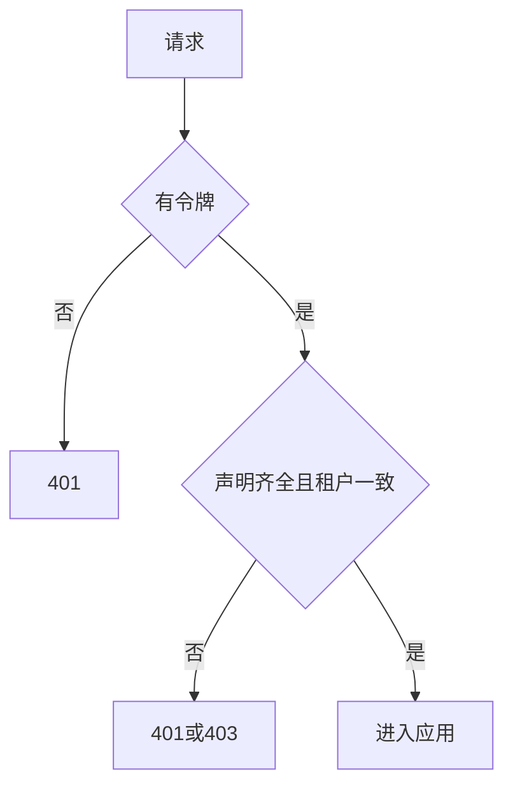

# 身份场景册

## S-IDN01 凭令牌进入应用

| 步 | 动作 | 失败 |
|---|---|---|
| 1 | 读取 Bearer | 无则 RC-AUTH-MISSING |
| 2 | 桥接核验，要求租户、用户、项目齐全 | 超时或缺失则拒绝，只调用一次 |
| 3 | 设置数据库会话变量 | 设置失败则拒绝，不继续查询 |
| 4 | 确认用户是该应用成员 | 不是则 RC-PERM-DENIED |

## S-IDN02 授予应用角色

应用管理员提交角色列表。空列表表示移除。同一事务写成员和审计队列。

## S-IDN03 越权被拒绝

没有权限点，或行过滤后没有可见行。没有权限点时返回 403，不返回空表。行过滤后确实没有数据才返回空列表。两者不能混用。
