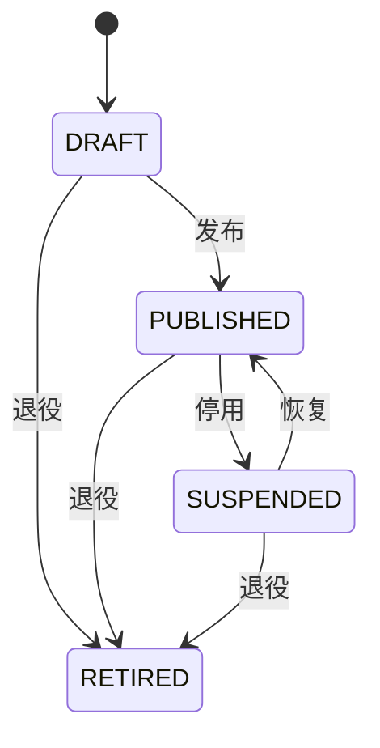

# 总体设计方案

关联决策 D-001 至 D-016。需求编号见 `01-需求分析.md`。

## 1. 位置

```
业务用户浏览器
    │
    ▼
基座外壳（React）──读取页面模式、提交实体命令
    │
    ▼
基座服务（Java，独立进程）
    │  身份上下文、应用、路由、服务目录、
    │  页面模式、实体、查询、语义包、安装事务
    │
    ├── PostgreSQL（基座元数据 + 托管业务表）
    ├── 外接 PostgreSQL / MySQL / REST（只经连接器）
    │
    └── 只经桥接调用 gnex
            认证令牌、租户边界、组织只读、
            审批、审计、凭证引用、智能体工具入口
```

gnex 继续做规划、调度和运行。基座不做这些。业务系统是装进基座的应用包，不是再做一个 gnex 插件目录。

## 2. 进程与模块

一个 Spring Boot 进程，Maven 多模块。模块之间只经本服务的 Java 接口调用，禁止跨模块直接写对方的表。

| 模块 | 职责 | 保护 |
|---|---|---|
| daf-api | HTTP、错误体、租户上下文过滤器 | 内核 |
| daf-idn | 成员、应用角色、数据权限 | 内核 |
| daf-app | 应用注册、状态、路由、菜单投影 | 内核 |
| daf-svc | 业务服务目录、绑定、健康 | 标准 |
| daf-ui | 页面模式、区块注册、外壳所需读模型 | 内核 |
| daf-dat | 数据源、实体、查询与命令 | 内核 |
| daf-sem | 语义包、组装事务 | 内核 |
| daf-pkg | 清单安装、升级、回滚 | 内核 |
| daf-brg | 调用 gnex 的唯一出口 | 内核 |
| daf-shell | 浏览器外壳与官方渲染器 | 标准 |

首版不把业务 jar 装进基座进程。需要业务规则时，清单写一个 HTTP 钩子，指向已经登记的 `biz.` 服务。该调用失败或返回拒绝，命令就不写库。基座发行包不包含具体行业规则。

## 3. 请求怎么走

1. 外壳把 gnex 令牌放在 `Authorization`。
2. `daf-api` 调用桥接校验令牌。失败返回 `RC-AUTH-MISSING` 或 `RC-TENANT-MISMATCH`，不进入业务模块。
3. 过滤器把租户、用户、项目放进线程上下文，并在事务内 `SET LOCAL` 会话变量 `daf.tenant_id` 与 `daf.project_id`。`LOCAL` 随事务结束消失，连接归还后不得残留。
4. 应用模块确认应用属于该租户且状态允许访问。
5. 身份模块确认成员和权限点。
6. 数据模块执行查询或命令。查询条件由权限行过滤与租户条件拼接，调用方传入的过滤不能覆盖这两段。
7. 写元数据或业务行之后，桥接投递审计。投递失败写入表 `outbox`，进程内定时重试。

## 4. 数据放哪

| 数据 | 存放 | 说明 |
|---|---|---|
| 应用、路由、成员、角色、页面模式、语义包、服务目录 | PostgreSQL 模式 `daf` | 全部带 `tenant_id` 与 `project_id` |
| 托管业务行 | 同库模式 `biz`，表名 `t_<租户短码>_<实体键>` | 带 `tenant_id` 与 `project_id`。短码避免表名冲突 |
| 外接业务行 | 客户的库或 REST | 基座不搬迁数据 |
| 密钥 | 不存放 | 只存 gnex 凭证引用号 |
| 智能体会话 | 不存放 | 仍在 gnex 会话 |

行级安全策略同时要求 `tenant_id` 与 `project_id` 等于对应的会话变量。应用角色不是表属主，并强制走策略。应用代码里的 `WHERE` 是第二道。外发队列使用另一个数据库角色，只能读写 `daf_outbox`，避免没有请求上下文的重试线程读不到行，也不能借此角色读取业务表。外接库不套用这条 PostgreSQL 策略。

## 5. 应用状态



已退役不可再发布。停用期间，非应用管理员访问路由得到 403，文案 `RC-PERM-DENIED`。应用管理员仍可读取配置。非法状态迁移得到 409，文案 `RC-APP-STATE`。

## 6. 和智能体的关系

gnex 工具注册表增加一组基座工具，工具实现在 `daf-brg` 暴露的 HTTP，不在智能体进程里访问数据库。

| 工具 | 作用 | 限制 |
|---|---|---|
| biz.describe | 读语义包和实体 | 只读 |
| biz.propose | 提交组装提议 | 不落地 |
| biz.validate | 校验提议 | 不落地 |
| biz.apply | 落地 | 已发布应用必须先有审批号 |
| biz.query | 按实体查询 | 走统一查询，带权限 |

工具名是给模型看的。正式接口仍是 HTTP，见 `06-总体设计/07-接口设计.md`。

## 7. 分批

| 批次 | 内容 | 完成线 |
|---|---|---|
| P0 | 令牌接入、应用、路由、托管实体、列表和表单、安装回滚、审计外发 | 标准包 60 秒内可打开；串租户测试为 0 |
| P1 | MySQL 与 REST 连接器、服务目录、组装事务、审批落地 | 智能体三次工具调用内完成草稿页提议；已发布落地无审批号则失败 |
| P2 | 列打码、跨源上限拒绝、升级迁移、第二渲染器适配点 | 跨源超限必拒；跳版升级必拒 |

P0 不做的，规格里写在 §10，避免实现时顺手做完。

## 8. 失败时用户看到什么

错误体只有四字段：`code`、`message`、`traceId`、`details`。`code` 与 `message` 的中文全文以 `specs/00-literals.md` 为准。日志可以有栈，响应里不给栈，也不给 SQL。

## 9. 部署

基座与 gnex 同集群不同部署。就绪探针只检查本进程和本库，不把 gnex 不可用当成基座未就绪。gnex 核验不可用时，除健康检查外全部接口拒绝，不读页面缓存，也不保存核验成功的结果。已经写入外发队列的审计仍由队列角色重试。

配置全部来自环境变量或配置文件，规格中的默认值见各模块 §7。连接串不属于页面模式。
