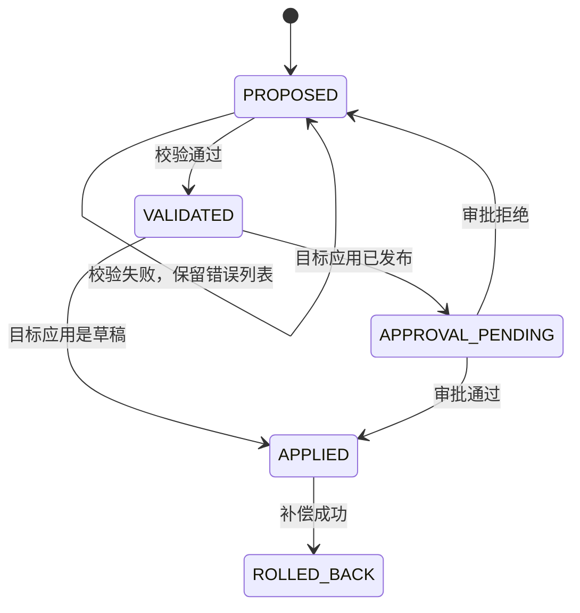

# 智能组装设计

本文件是组装规则的唯一说明。模块规格只引用，不另写一套状态机。

## 1. 语义包里有什么

一份语义包是一个 JSON 文档，版本号用 `主.次.修订`。

| 段 | 内容 | 约束 |
|---|---|---|
| entities | 实体键、字段、字段类型、必填 | 类型必须在字面量库的类型表内 |
| actions | 动作键、作用实体、是否写 | 写动作才会产生命令 |
| constraints | 可执行的约束表达式 | 只允许比较、与、或、非、枚举。禁止函数调用 |
| uiHints | 字段中文名、区块偏好（表格列或表单） | 偏好不是页面模式本身 |
| packageRef | 所属应用包版本 | 可空，表示临时草稿包 |

未知键：校验直接失败，错误码 `RC-SEMANTIC-UNKNOWN`。

## 2. 组装事务

| 现态 | 事件 | 次态 | 动作 |
|---|---|---|---|
| PROPOSED | 校验通过 | VALIDATED | 写入校验摘要 |
| PROPOSED | 校验失败 | PROPOSED | 只追加错误，不改应用 |
| VALIDATED | 目标已发布且审批提交成功 | APPROVAL_PENDING | 调用桥接提交审批，保存返回的审批号 |
| VALIDATED | 目标已发布但提交失败 | VALIDATED | 不进入待审批 |
| VALIDATED | 目标是草稿 | APPLIED | 在同一数据库事务里写页面、实体差异和路由 |
| APPROVAL_PENDING | 通过且审批号匹配 | APPLIED | 同上 |
| APPROVAL_PENDING | 拒绝或超时 | PROPOSED | 不写正式版本 |
| APPLIED | 补偿 | ROLLED_BACK | 恢复该事务记录的前像 |

超时：审批等待 24 小时，到点视为拒绝。`[设计·惯例]` 企业变更单不过夜仍未批则退回。复决：若 gnex 审批规格给出不同超时，改为跟随 gnex，本数字作废。

## 3. 智能体允许的步骤

1. `biz.describe` 读取当前语义包。
2. `biz.propose` 提交差异：新增字段、新增页面、改绑定。差异是结构化对象，不是一段说明文字。
3. `biz.validate`。失败则修改提议再校验。成功落地见状态机。

从提议到草稿落地，工具调用不超过 3 次（describe 可缓存，不计入这 3 次）。超过仍可人工在界面提交，不受此限。此限用来约束工具设计，避免模型用十次微调用绕过校验。

## 4. 落地时写哪些表

同一数据库事务：

- 实体差异（只允许加可选字段、加页面、改 uiHints）。禁止在组装事务里删字段、改字段类型。这类变更走应用包升级。
- 页面模式新版本。旧版本保留，路由指向新版本。
- 事务行写入前像，供回滚。

删除字段、改类型、改数据源，必须走应用包升级（`FR-PKG-03`），因为那会动物理表。

## 5. 组合是否合法

| 规则 | 不合法时 |
|---|---|
| 页面绑定的实体必须属于同一应用 | `RC-SCHEMA-INVALID` |
| 写动作必须有对应命令钩子或内置命令 | `RC-SCHEMA-INVALID` |
| 区块类型必须在首版六种之内 | `RC-SCHEMA-INVALID` |
| 已停用、已退役应用拒绝组装 | `RC-APP-STATE` |
| 提议者不是该应用成员且不是平台管理员 | `RC-PERM-DENIED` |

## 6. 和审批的边界

基座不实现审批流。它只保存 gnex 返回的审批号，并在落地时再向 gnex 核对一次状态。核对失败按未批准处理。禁止缓存「刚才批准过」超过单次请求。
